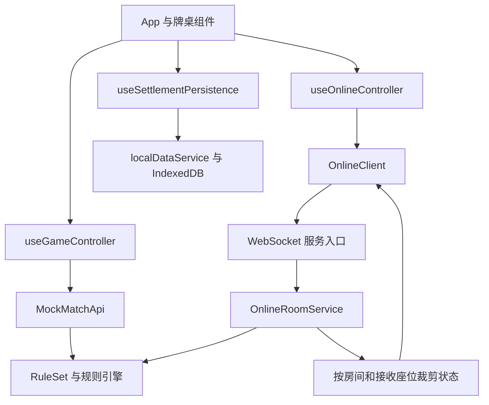

# 打索子项目 AI 开发交接说明

> 更新日期：2026-11-12。本文依据当前工作区源码、配置、脚本和已有文档编写，供其他 AI 接手开发。
> 本次更新包含从 `ef78300` 开始的三维牌桌重构与交互调整。开发过程中已在内置浏览器运行并检查相关交互；构建、类型检查和静态检查的最终结果以本次交付记录为准，本文不代表线上或原生真机验收。

## 1. 项目概况与当前状态

项目名称是“打索子”，仓库目录名为 `PaiGow`，npm 包名为 `da-suo-zi`，当前版本为 `1.2.0`。它将江西省吉安市富滩镇新居村的四人传统骨牌玩法数字化，主要用于地方玩法记录、规则学习和娱乐练习。

当前源码已经包含以下能力：

- **单机对战**：一个真人对三个机器人，支持入门、标准、专家三档难度。
- **定制练习**：指定自己的部分或全部起手牌，最多 8 张；不足部分随机补齐，不计本机积分。
- **多人联机**：WebSocket 房间、大厅列表、六位房间码、真人与机器人混合对局、断线恢复及机器人临时代打。
- **本机数据**：用户、头像、积分流水、最近战绩、声音和动画设置保存在 IndexedDB。
- **牌桌表现**：原生 Three.js 木桌和实体骨牌、3D 骰碗、随机摆墩与抓牌翻面演出、手牌整理和即时拖动换位、垒牌落位音效、座位喊声、回合查看及整局复盘。
- **移动应用容器**：Capacitor Android/iOS 工程，与 Web 共用前端源码。

产品约束：积分没有货币价值，不可购买、转让或兑换；项目没有真钱充值、提现、抽成或支付能力。界面使用“奖励分”“无门弃牌”“先手”等现有表述。不要自行改变玩法定位或恢复已经调整的旧文案。

### 1.1 仓库与分支

| 项目 | 本次读取结果 |
| --- | --- |
| 本机目录 | `/Users/june/Documents/Codex/PaiGow` |
| 本次开发分支 | `redesign-3d`；用户要求本次交付合入 `master` 并推送主远端 |
| `origin` | `https://gitlab.qdkl.cn/zhouyong/paigow.git` |
| `github` | `https://github.com/junegod/paiGow.git` |
| 原始基线 | `ef78300`；本次三维重构以前的 `main` |
| 在线体验地址 | README 记录为 `https://game9.qdkl.cn/`，本次未访问核验 |

远端默认分支在本次交付前为 `main`，此前没有 `master`；本次按用户要求从最新 `origin/main` 建立 `master` 并合入开发分支。该操作不改变远端默认分支。接手时重新查看实际分支、上游和完整 diff，提交与推送结果以 Git 记录为准，发布需单独执行。

## 2. 推荐阅读顺序

| 顺序 | 文件或目录 | 要了解的内容 |
| --- | --- | --- |
| 1 | 当前用户规范、适用的 `AGENTS.md` | 开发约束、注释、交付与授权范围 |
| 2 | `README.md`、`package.json` | 产品定位、依赖、脚本与运行方式 |
| 3 | `打索子规则.md` | 本地玩法细则，尤其是赏、最后一手与结算 |
| 4 | `src/rules-core/types.ts` | 牌实例、牌型、动作、对局状态、机器人观察模型 |
| 5 | `src/rules-variants/ji-an-da-suo-zi/` | 规则、牌目录、计分和机器人真实实现 |
| 6 | `src/App.tsx`、`src/app/` | 单机与联机入口、动画门禁、积分保存和恢复流程 |
| 7 | `src/services/online/`、`server/` | 联机协议、身份、座位视角、广播与房间生命周期 |
| 8 | `src/local-data/` | 本机存储、积分幂等、旧数据兼容 |
| 9 | 相关 `__tests__/`、`server/roomService.test.ts` | 已有场景和回归约束；存在测试不代表当前已通过 |
| 10 | `docs/ios/APP_STORE.md`、发布流水线 | 原生构建限制、隐私及交付环境 |

`README.md` 的目录说明仍把 mock 描述为“当前纯前端”边界，但源码已经有独立联机服务。应结合本文及真实调用链理解。规则文档与实现如有冲突，先定位差异和已有测试，向用户确认业务口径，不要凭其他地区牌九经验覆盖本地规则。

## 3. 技术栈与目录导航

| 层次 | 当前技术与用途 |
| --- | --- |
| 前端 | React 19.2、TypeScript 6、Vite 8，ES Module |
| 动画与 3D | Framer Motion、原生 Three.js；已移除 React Three Fiber 和 Drei |
| 联机后端 | Node.js、`ws`，HTTP 健康响应与 WebSocket 共用端口 |
| 本地持久化 | IndexedDB；联机会话与同意记录另用 localStorage |
| 质量工具 | Oxlint、Vitest、Testing Library、jsdom、fake-indexeddb |
| 移动容器 | Capacitor 8.4.1，Android Gradle 与 iOS Swift Package Manager |
| 包管理 | pnpm，仓库有 `pnpm-lock.yaml`；GitHub CI 使用 pnpm 10 |

```text
src/main.tsx                         React 挂载入口
src/App.tsx                          大厅/牌桌组合、单机/联机切换、离局与记分门禁
src/app/                             单机、联机、授权、恢复、结算保存 hooks
src/rules-core/                      通用类型、集合和随机数工具
src/rules-variants/ji-an-da-suo-zi/    本地玩法规则、牌目录、计分、理牌、机器人
src/services/mock-match-api/         单机内存牌局服务
src/services/online/                 WebSocket 客户端、协议、会话和座位转换
src/local-data/                      本机用户、积分、战绩和设置
src/ui/components/                   首页、三维牌桌桥接、规则、设置、复盘等
src/ui/table3d/                      场景、牌体几何与材质、布局映射、拖动、骰碗和运动
src/ui/hooks/useOpeningCeremony.ts   开局演出时间轴及音效，不修改规则状态
src/ui/audio/                        音效与人物喊声
src/ui/styles/                       已拆分的组件样式
src/index.css                        全局、弹窗、本机数据与联机界面样式
src/test/                            测试初始化、牌局夹具和 FakeWebSocket
server/                              独立联机服务，直接复用同仓规则引擎
scripts/                             机器人审计、联机检查和 iOS 打包脚本
public/sounds/                       游戏音效和四座位喊声素材
public/privacy.html                  随包提供的静态隐私说明
assets/app-icon/                     应用图标源文件与母图
docs/screenshots/                    README 引用的界面截图
android/、ios/                       原生工程
Jenkinsfile                          Web 静态资源发布流水线
Jenkinsfile.online                   联机服务独立发布流水线
.github/workflows/android-apk.yml    Android 调试 APK 构建与标签发布
```

`dist/`、`dist-server/`、`dist-dev/`、`artifacts/`、`release/` 等为忽略目录中的构建或检查产物，不是源码入口，也不能据其存在认定当前版本构建成功。

## 4. 本地启动与配置

### 4.1 开发环境

建议使用与 Jenkins 一致的 Node.js `22.22.2` 和 pnpm 10；Android 还需 JDK 21、Android SDK Platform 36 和对应构建工具，iOS 需 macOS、Xcode 26+ 及匹配的 iOS 平台组件。实际兼容范围以所安装依赖要求为准。

在项目根目录安装并启动前端：

```bash
pnpm install --frozen-lockfile
pnpm dev
```

前端配置端口为 `5173`，监听 `0.0.0.0`，默认访问 `http://127.0.0.1:5173/`。同一局域网手机可以使用电脑 IP。端口被占用时以 Vite 实际输出为准。

单机不需要启动后端。开发联机功能时，另开终端在根目录启动：

```bash
pnpm online:server
```

服务端默认监听 `0.0.0.0:8787`。Vite 开发服务和预览服务都把 `/ws` 代理到 `ws://127.0.0.1:8787`，浏览器正常使用同域 `/ws` 即可。HTTP 请求返回 `ok`、服务名和规则修订标识，不提供完整 REST 业务接口。

### 4.2 环境变量

| 变量 | 所属进程 | 当前行为 |
| --- | --- | --- |
| `PORT` | 联机服务 | 默认 `8787`；修改后还需自行对齐 Vite 代理或反向代理 |
| `VITE_ONLINE_WS_URL` | Vite 前端 | 优先采用指定 WebSocket 地址；生产包需在构建时传入，属于公开配置 |
| `ONLINE_WS_URL` | 联机 smoke 脚本 | 默认 `ws://127.0.0.1:8787` |
| `E2E_BASE_URL` | 浏览器 E2E 脚本 | 默认是线上 `https://game9.qdkl.cn`；本地执行须明确改为本地地址 |
| `E2E_PLAYWRIGHT_CORE` | 浏览器 E2E 脚本 | 指向可动态导入的 `playwright-core` 模块文件；默认借用了作者另一个本机仓库路径 |
| `DEVELOPER_DIR` | iOS 构建脚本 | 可指定 Xcode；未设置且默认 Xcode 存在时，脚本为子进程选择该路径 |

WebSocket 地址逻辑见 `src/app/onlineControllerSupport.ts`：优先使用 `VITE_ONLINE_WS_URL`；页面协议为 `capacitor:` 或 `ionic:` 时回退到 `wss://game9.qdkl.cn/ws`；其他页面按当前域名和 HTTP/HTTPS 推导 `/ws`。

原生 WebView 的实际协议因平台配置而异，不能假设所有原生安装包都会命中远程地址兜底。尤其本地 `http(s)://localhost` 页面会走同域推导；原生联机发布前应明确配置地址并真机确认。当前没有必须填写的业务密钥或数据库连接配置。

### 4.3 构建与预览

```bash
pnpm build
pnpm preview
```

`build` 执行 `tsc -b` 和 Vite 前端构建，输出 `dist/`。独立联机产物使用：

```bash
pnpm build:server
node dist-server/main.mjs
```

服务端构建通过 Vite SSR 将依赖打包，配置 `ssr.noExternal: true`，产物重命名为 `dist-server/main.mjs`。不要把服务器入口误当成前端静态资源一起部署。

## 5. 核心架构与修改入口



### 5.1 规则与状态

- `rules-core/types.ts` 定义 `MatchState`、`RoundState`、`TurnAction`、`PreparedAction`、`RuleSet` 等契约。
- `ruleSet.ts` 将本地玩法组装为 `jiAnDaSuoZiRuleSet`，单机与联机共用。
- `engine.ts` 提供 `createInitialMatch`、`startRound`、`listTurnActions`、`previewSelection`、`submitAction`、`finishRoundAndReveal` 等核心入口。
- 主要阶段为 `lobby → playing → awaiting-reveal → settled`。最后一个回合完成后先等待整局揭示，再翻开暗牌并计算结算。
- `MatchState` 包含当前局、已结算历史局、随机种子和上局最后赢家；`RoundState` 包含四座手牌、当前回合、待定门选择、公开记录、赏结果和结算。

修改合法动作或玩法限制时，优先修改规则层并核对选择预览、动作枚举和提交校验，避免只改按钮或提示。联机客户端的预览不能代替服务端最终校验。

### 5.2 单机与界面

`MockMatchApi` 是真实单机状态边界，使用可指定种子的随机源，返回状态快照；未显式给种子时使用运行期熵。固定 seed 适合复现场景，正常游戏入口不应改成固定发牌。

`useGameController.ts` 负责将服务状态转为 React 状态，并处理机器人轮次、选牌、理牌、开局演出、骰子展示和回合停留。跳过开局动画只改变显示，不跳过引擎中的发牌与先手确定。

常见 UI 修改位置：

| 需求 | 优先阅读 |
| --- | --- |
| 首页、难度、定制起手牌 | `LobbyPanel.tsx`、`OpeningHandPicker.tsx`、`LobbyBackdrop.tsx`、`LobbyScene.ts`、`src/app/botDifficulty.ts` |
| 选牌、出牌、手牌拖动 | `Table3D.tsx`、`TableScene.ts`、`handDragController.ts`、`ActionPanel.tsx`、单机/联机控制器 |
| 三维牌面、厚度与光照 | `tileFactory.ts`、`tileGeometry.ts`、`tileSurface.ts`、`tableMetrics.ts`、`roomBuilder.ts` |
| 弹窗牌面与首页标志 | `PaiCard.tsx`、`BrandMark.tsx`、`cardCatalog.ts`、`src/ui/cardPresentation.ts` |
| 3D 骰碗与开局演出 | `diceFactory.ts`、`diceAnimator.ts`、`useOpeningCeremony.ts`、`tableView.ts`、`diceTiming.ts` |
| 回合、赢墩和复盘 | `arenaLayout.ts`、`tableView.ts`、`tileMotion.ts`、`collectionTiming.ts`、`InspectorDrawer.tsx`、`src/ui/gameInspection.tsx` |
| 规则与操作帮助 | `RulesPanel.tsx`、`GameHelpPanel.tsx`、`src/ui/turnGuidance.ts` |
| 设置、声音和隐私 | `SettingsPanel.tsx`、`PrivacyPanel.tsx`、`src/ui/audio/`、`public/privacy.html` |
| 结算保存与离局确认 | `App.tsx`、`useSettlementPersistence.ts`、`LeaveConfirmDialog.tsx` |

音效来源与替换方式见 `public/sounds/README.md` 和授权文件。牌面由代码绘制，应用图标也引用相同牌面设计；替换素材时需保持玩法可辨识性和来源授权。

### 5.3 三维表现与本次交互约束

- `Table3D.tsx` 连接 React 状态和 `TableScene`，场景实例只创建一次，回调经引用读取最新控制器。卸载时释放渲染器、监听器和资源。
- `tableView.ts` 将规则快照映射成纯展示位置；牌局身份和牌面身份分开管理。洗牌与垒牌阶段只有牌背，抓牌后只翻本方牌；联机快照中的占位牌不能显示真实点位。
- 开局牌墩的数量、每墩张数与轻微错位模拟线下摆牌；正式出牌和亮出的手牌保持端正。开局动画不改变规则层已经确定的发牌或先手。
- `HandDragController` 使用固定槽位判断跨槽换位，拖动时整张实体牌一起进入前景，并立即回报新顺序；松手吸附到新槽，取消手势则恢复原顺序。
- `tileMotion.ts` 负责插值和落位回报；`collectionTiming.ts` 集中维护收墩节奏。每次收牌只让一张代表牌回报碰撞，避免四张牌叠加音量；重建旧牌堆、原地翻牌不补播落桌声。
- 抓牌和亮牌阶段保留刚掷出的骰子。是否能掷骰仍由当前规则动作决定，骰碗点击不绕过控制器门禁。
- 本次视觉方向为木棕、米白和少量朱红；规则与定制选牌页面采用纸色背景，移除冗余牌底框和规则窗外层黄框。通用回合详情及结算仍保留原有部分样式，后续调整应按具体界面核对。
- 单机机器人称呼由 `villageSeats.ts` 从村里称呼池抽取，同桌不重复；使用独立随机源，不能改变规则层发牌随机数序列。

## 6. 必须保持的本地玩法约束

完整规则见 `打索子规则.md`，此处列出开发最容易误改的部分：

1. 四人、32 张牌、每人 8 张，顺时针。长门 14 张、幺门 8 张、点子门 10 张。
2. 一次赢得的墩数按该次领出的牌张数计算；所有座位最终赢墩合计为 8，不能按四家打出的 32 张计算成 32 墩。
3. 门类不能随意跨门比较；对子及长门组合有自己的比较组。牌定义见 `cardCatalog.ts`，组合和活赏吃法见 `patternCatalog.ts`。
4. 每局第一回合首次领出额外允许任意单张，此时不提供掷骰；不能由此放开任意多张组合。
5. 后手一般可以主动不吃，按相同张数背面弃牌；**面对活赏持有九九、七七、五五时必须吃，八八不能吃赏**。
6. 掷骰定门后有该门必须明出该门一张；没有该门才可背面弃一张。无门弃牌仍保留定门，后手可用该门单张明吃。
7. “安全单张”依赖当时已正面公开的牌；背面弃牌不能提前当成已知牌。符合规则的安全单张可以合并领出。
8. 活赏由三和六组成，可被指定点子对子吃；被吃后不产生奖励分。死赏不能吃，也不产生奖励分；其背面摆法只是公开牌型标记。
9. 最后两张出赏称为“孵赏”。最后合法整手或安全单张组合可直接明出；散牌不能一概强制一次出完。
10. 第一局通过两轮掷骰确定先抓先出；后续由上一局最后赢家的对家掷骰确定先手。
11. 暗弃牌必须等整局结束后统一揭示，不能在每个回合结束后提前翻开。明牌历史可随时查看。
12. 正常非满八墩结算，其他三家先按 `赢墩数 - 4` 计算基础分，最后一墩赢家承接其净额，不能把四家都直接算成 `赢墩数 - 4`。

### 6.1 计分与钱包要分开

计分入口为 `scoring.ts` 的 `calculateSettlement`，规则结算四座位总分变化应为零。

| 场景 | 规则计分 |
| --- | --- |
| 普通活赏未被吃 | 除赏持有者外，未满 3 墩者每人额外扣 2 分，3 墩及以上免付 |
| 非满八墩的孵赏未被吃 | 同样的付款范围，每人额外扣 4 分 |
| 满 8 墩，无有效活赏 | 三家各扣 8 分，赢家加 24 分 |
| 满 8 墩，中途有效活赏 | 三家各扣 10 分，赢家加 30 分 |
| 满 8 墩，有效孵赏 | 三家各扣 16 分，赢家加 48 分 |

本机钱包另有余额封顶和系统补分规则，实际落账变化可能不同于规则结算。不要把钱包防负数或免费补分写进零和规则引擎。

### 6.2 ID 与版本标识

- `CardDefinition.id` 是牌种身份；中文名、别名只作显示，不用于规则分支。
- `CardInstance.id` 区分一副牌中的具体副本，选牌和动作提交用实例 ID；每次生成牌组会复用稳定实例 ID，不能将其当成跨局全局唯一标识。
- 积分按用户、`matchId` 和 `roundNumber` 组合标识一局，不用牌 ID 去重。
- `RULE_ENGINE_REVISION` 当前值为 `2026-06-30-random-runtime-seed-v1`，用于单机热更新实例识别，也通过服务端健康信息暴露；它不是 npm 版本号或最新修改时间。
- `ONLINE_PROTOCOL_VERSION` 当前值为 `2026-09-05-room-v2`，客户端发送时附带，服务端不一致时拒绝。修改协议需同时核对前后端及 smoke 脚本内的固定版本字符串。

## 7. 机器人策略

机器人从规则引擎生成的合法动作中选择，通过 `createBotDecisionContext` 接收脱敏观察。

| 难度 | 主要文件与行为 |
| --- | --- |
| 入门 `beginner` | `botBeginnerEvaluation.ts`，允许合法但不够稳健的常见新人决策 |
| 标准 `standard` | `botStrategy.ts`、`botStrategyAnalysis.ts`、`botStrategyScoring.ts` 等启发式评估 |
| 专家 `expert` | `botExpertEvaluation.ts`、`botExpertSimulation.ts`，按公开信息抽样未知牌分布，当前每个候选动作抽样 64 次 |

策略不得接收真实对手手牌或未揭示弃牌。`botObservation.ts` 将暗牌转成张数与空牌面；专家未知牌池包含对手手牌及未知弃牌，不能直接取完整状态推演。增强难度时保持这个信息边界。

单机难度是设备级设置，切换本地用户不会改变；更新后影响后续决策，不重建当前牌局。联机调度当前使用规则集默认标准策略，单机的难度选择不会自动传到联机服务。

## 8. 联机服务与恢复机制

### 8.1 职责分工

| 文件 | 职责 |
| --- | --- |
| `server/main.ts` | HTTP/WS 入口、消息收发、连接关闭与进程退出 |
| `server/onlineProtocol.ts` | JSON、消息类型和协议版本的基础运行时校验 |
| `server/roomService.ts` | 创建/加入/恢复/离开房间、房主操作、真人动作校验、广播与维护 |
| `server/roomModels.ts` | 房间模型、公开摘要、按接收座位裁剪快照 |
| `server/roomLifecycle.ts` | 身份与连接查询、房主选择、断线玩家过期 |
| `server/roomBotScheduler.ts` | 机器人与断线真人代打，以及整局揭示调度 |
| `src/services/online/OnlineClient.ts` | 心跳、自动重连、消息发送与有限排队 |
| `src/app/useOnlineController.ts` | `offline/browser/lobby/match` 阶段、会话恢复、视角转换、交互 |
| `src/app/useOnlineReadiness.ts` | 身份和快照恢复完成前锁住操作 |

### 8.2 房间与身份边界

- 房间和权威牌局保存在 `OnlineRoomService` 的进程内存 `Map`，没有数据库或 Redis 持久化。重启会丢失房间，不能按无损发布设计操作流程；多个实例也不共享状态。
- 房间码为六位数字；最多四位真人，其余座位由机器人补齐。等待大厅分别显示在线人数和断线保留座位，并按已占座数判断是否可以加入。已开局房间不再接受新加入者，也不在等待大厅展示；已有玩家可用 token 恢复。
- 房主可以配置机器人名和开始牌局；已开局后只能在结算完成时开始下一局，不能在进行中任意重开。
- 身份为服务端生成的房间 token，同时绑定连接和座位。动作提交检查 token、当前 socket、在线状态以及动作座位，再由规则引擎验证合法性。
- token 只返回本人，不进入其他玩家公开列表。身份不是全站账号；不要把本机用户或昵称当成服务端认证。
- 断线身份保留 3 分钟，期间可以由机器人临时代打；超过期限清理为机器人。维护任务约每分钟执行，时间阈值不代表精确到秒的立即清理。
- 有其他在线真人时可迁移房主；全部真人主动离开时销毁房间。虽然还定义了 6 小时无真人活动 TTL，断线玩家过期且无人留下也可能更早清理，不能承诺房间一定保留 6 小时。

### 8.3 广播与座位视角

服务端通过 `createMatchStateForSeat` 生成接收者专属快照：保留本人的手牌，清空其他座位手牌，并替换未揭示弃牌。占位对象的牌定义不能作为真实牌面使用。

广播必须先锁定具体房间，再逐一生成接收者视角并投递到其连接。不同房间都存在座位 0/1/2/3，禁止按全局座位号查找 socket 或共享一份未裁剪快照。

客户端 `viewerState.ts` 和 `viewerSeats.ts` 把本人服务端座位旋转为界面座位 0，保证自己始终坐底部。当前回合、先手、赢家、赏持有者、结算及历史局等深层字段都要一并转换；提交动作使用真实服务端座位。新增座位字段时必须检查双向映射，避免非房主拿不到手牌或不能出牌。

### 8.4 重连与联机同意

- 首次联机必须通过 `useOnlineConsent.ts` 的说明确认。单机首页不主动建立联机连接；已同意且仍有会话时允许恢复。
- localStorage 键为 `da-suo-zi.online-consent.v1` 和 `da-suo-zi.online-session`。数据用途有实质变化时需评估同意版本；撤回同意应退出房间并停止连接。
- 客户端每 25 秒探测心跳，连接/响应超时为 10 秒；重连采用退避，最长间隔 5 秒。房间身份快照另有 10 秒恢复期限。
- WebSocket `connected` 不等于可操作，需收到创建、加入或恢复身份的确认快照。切回前台先通过现有连接核对身份并取快照，确认超时才重连；等待快照时保留牌桌并暂时禁用出牌和开局。
- 同房间快照用递增 `revision` 拒绝旧版本；主动离开后拒绝迟到恢复消息。
- 实时掷骰快照触发各端共用的局内翻滚与结果停留；恢复快照中的旧点数不重播。联机机器人等本次结果展示完再定门出牌。
- 断线时不排队补发 `submit-action`、`start-match`、`configure-bots`，避免旧回合动作重放；查询消息做同类型合并。

## 9. 本机存储、积分与异常处理

数据库为 `da-suo-zi-local-data`，当前 IndexedDB schema 版本为 `1`，对象仓库为 `userProfiles`、`scoreLedger`、`matchHistory`、`appSettings`。轻量字段兼容与钱包迁移由 `localDataService.ts` 处理，钱包规则版本当前为 `3`，与数据库 schema 版本含义不同。

- 用户是本机档案，首次初始化创建默认用户；没有账号注册、云同步或跨设备共享钱包。
- 统计由积分流水计算，最近战绩默认展示当前用户最近 6 局的摘要；本机历史摘要不等于保存了可恢复的整局牌面。
- 新用户赠送 100 分，余额耗尽后系统免费补分；`recharge` 是兼容保留的流水类型，不代表支付充值。不要因展示改名而直接重命名旧存储键或枚举值。
- 只有正常单机积分局写本机结算。定制局和联机局均不写本机对局积分，不能因为联机牌桌显示了积分就推断它已经入账。
- 结算去重键为 `${userId}:${matchId}:${roundNumber}`。已有流水不重新计分，重试可补缺失历史；流水、历史写入并非一个跨仓库原子事务，不能宣传为事务性完整提交。
- `useSettlementPersistence` 共享同局正在执行的写入，处理自动落账、失败重试和离局门禁。保存失败时保留当前结算页，返回首页、菜单重开和下一局都要经过同一保存入口。
- 普通积分局进行中，经菜单确认“返回首页/重新开始”才扣系统防刷牌分，最多扣 4 分且不超过余额；刷新、关闭页面不自动扣分，旧未完成登记启动时清理而不追扣。
- 定制局、联机局、已结算局不走中途离局扣分。写入失败应保留当前操作状态并提示，不能先导航后补写。

本机牌局运行态主要在内存，IndexedDB 记录不构成单机中途存档。清除站点数据或卸载应用可能丢失本机资料；调试时不要为处理异常默认清库。

## 10. 已有验证入口与注意事项

以下为检查入口导航；是否执行以及实际结果以每次任务的交付记录为准。本次交付不运行自动化测试、机器人审计或联机集成脚本。

2026-11-12 交付检查已通过 `pnpm lint`、`pnpm build` 和服务端 `tsc --noEmit`；生产构建对包含 Three.js 的共享资源包提示超过 500 kB。此前已在内置浏览器检查开局、理牌、收牌等交互；未录音听验垒牌音质，也未做原生真机或线上验收。

| 命令 | 用途及范围 |
| --- | --- |
| `pnpm lint` | 按 `.oxlintrc.json` 运行 Oxlint |
| `pnpm test` | Vitest 单次运行；配置扫描 `src/**/__tests__/**/*.test.ts` 和 `server/**/*.test.ts` |
| `pnpm build` | 前端类型检查与生产构建 |
| `pnpm exec tsc -p tsconfig.server.json --noEmit` | 显式检查服务端类型；根 `tsconfig.json` 未引用该配置 |
| `pnpm build:server` | 服务端 SSR 打包，本身不等于完整服务端类型检查 |
| `pnpm audit:bots` | 三档各 100 局合法动作与对局审计，报告输出 `artifacts/bot-audit/<difficulty>/` |
| `pnpm audit:difficulties` | 比较相同公开局面的策略差异；当前阈值入门/标准 20%，标准/专家 6%，不等于胜率保证 |
| `pnpm online:smoke` | 向指定 WS 服务创建房间，查看基本响应 |
| `pnpm online:lifecycle` | 创建/加入、房主离开后迁移、新房主开局 |
| `pnpm online:isolation` | 两个房间之间的状态消息隔离检查 |
| `pnpm online:e2e` | 浏览器双客户端加入、手牌隔离、客人理牌与实际操作 |

已有测试覆盖规则引擎、机器人、理牌、mock 服务、本机存储失败与积分、结算重试、联机恢复、联机同意、客户端连接、座位转换、房间服务及声音。修改时按涉及模块阅读相应测试，不能把测试文件存在写成“已验证”。

脚本的已知限制：

- `online:*` 集成脚本会真实创建房间或推进牌局，不是纯离线检查。WS smoke 默认本地，浏览器 E2E 默认线上，执行前要确认目标。
- `onlineSmoke.mjs` 的 close 回调直接 `process.exit(0)`，可能覆盖先前错误状态；不能只凭它的退出码判定成功。
- `playwright-core` 不在本项目依赖中，E2E 默认引用 `/Users/june/IdeaProjects/e-law/node_modules/playwright-core/index.mjs`，其他机器必须配置可用模块及 Chromium。
- E2E 的新浏览器上下文进入大厅步骤未处理当前首次联机说明弹窗，和现有隐私流程需要重新对齐；本次未运行确认。

## 11. Android、iOS 与发布

### 11.1 原生构建

统一应用名“打索子”，Bundle ID / applicationId 为 `com.junegod.dasuozi`。Capacitor 从 `dist/` 同步本地 Web 资源，不是远程网页首页。

| 平台 | 命令与当前配置 |
| --- | --- |
| Android | `pnpm android:sync`、`pnpm android:open`、`pnpm android:build`；minSdk 24、compile/target SDK 36，`versionName=1.2.0`、`versionCode=3` |
| iOS | `pnpm ios:sync`、`pnpm ios:open`、`pnpm ios:build`、`pnpm ios:archive`；iPhone 竖屏，最低 iOS 15.4，工程版本 1.2.0、build 1 |

`scripts/buildIos.mjs` 使用 `CODE_SIGNING_ALLOWED=NO`：`ios:build` 目标为模拟器应用，`ios:archive` 目标为未签名设备归档，都不是可直接上架的签名 IPA。输出目录为 `artifacts/ios/` 和 `release/`。

详细上架准备及历史限制见 `docs/ios/APP_STORE.md`：该文档记录 2026-09-26 因缺少匹配 iOS 运行平台而未成功生成应用/归档，未完成正式发行签名与商店上传。这是历史记录，本次未重查 Xcode、证书、平台安装或真机状态。

发布版本时需同步核对 `package.json`、Android 版本号及版本码、iOS marketing/build 号。iOS 打包脚本读取 package 版本，但不能因此假设全部平台版本和递增构建号自动同步。

### 11.2 现有流水线

| 流水线 | 仓库中的配置行为 |
| --- | --- |
| `Jenkinsfile` | 构建 Web、打包 `dist`、发布 nginx 静态目录；默认 APP_NAME 为 `game9`，支持 `SKIP_DEPLOY` |
| `Jenkinsfile.online` | lint、单测、服务端打包，部署 `main.mjs` 并重启 systemd `paigow-online`；默认部署目录 `/data/project/online/paigow`，端口 `8787` |
| Android GitHub Actions | 手动触发或推送 `v*` 标签；执行 lint、单测、机器人审计、前端构建、Gradle `assembleDebug`；标签触发时上传 GitHub Release |

这些是仓库配置，不证明 Jenkins 任务、远端机器或线上版本当前一致。本次没有连接发布系统。

后续发版需关注：

- 前后端流水线独立；规则、协议或服务端生成文案改变时，要协调前后端版本。静态资源发布不能代替联机服务发布。
- `Jenkinsfile.online` 的默认远端可执行文件仍名为 `/usr/local/bin/node16`，与构建使用 Node 22 的配置不同，部署前检查真实二进制版本和兼容性。
- 联机流水线只在首次创建 systemd 单元，后续不会覆盖既有单元；修改流水线默认参数不一定修改已存在服务的运行配置。
- TLS、域名和 `/ws` 的 nginx Upgrade 转发属于运行环境，仓库没有完整的反向代理配置，需要另行核实。
- GitHub 生成的是调试 APK。正式 Android 签名、Apple 发行签名和商店发布是独立步骤，不能把本地产物当成正式发行包。
- 隐私支持渠道、基础设施日志规则、联机昵称内容治理及商店发行资料仍需按 iOS 准备文档确认；现有草稿不能代替完成证明。

## 12. 接手开发时的工作约定

1. 先查看工作目录、分支和完整 diff，保留其他人已有修改；先读本地标准实现及调用链，再决定扩展位置。
2. 通用规则放在 `rules-core` 或规则变体；房间生命周期放在服务端；本机钱包放在 `local-data`。避免在组件、客户端和服务端复制多份计分或合法性判断。
3. 新增/修改前端类型、组件、hooks、函数时提供中文多行 JSDoc，按签名写参数与返回值；身份边界、状态变化、异步失败、幂等及兜底还需对应中文行内说明。禁止单行块注释。
4. 使用现有 `@/` 别名、明确类型及标准入口；不要为了迁就 UI 修改稳定 ID、存储键、旧流水类型或协议契约。
5. 避免继续堆大文件。规则引擎、本机数据服务、全局样式、`App.tsx`、控制器、`TableScene.ts` 和 `tableView.ts` 都较大；收牌时间与运动已经分别抽出 `collectionTiming.ts` 和 `tileMotion.ts`。新功能先评估按规则校验、数据转换、存储、展示等职责做最小拆分，不顺带重排无关代码。
6. 替换方案后检查本次直接残留的请求、类型、组件、脚本、测试和文档；删除公开契约前核对调用，不留下空壳或重复入口。
7. 交付前逐文件审阅完整 diff，核对规则边界、隐藏信息、房间隔离、座位映射、失败重试和注释。按任务授权执行适用检查，明确报告实际执行结果及未验证范围。
8. 当前交接没有指定下一项业务需求。本文的限制和注意事项不是已批准的改造清单；后续按用户具体任务推进。提交需中文 commit，推送与发布按用户当次范围执行。

## 13. 可直接给接手 AI 的开场说明

> 你正在接手“打索子”项目。请先阅读根目录《AI开发交接说明.md》《README.md》《打索子规则.md》及当前适用规范，查看 git 状态，再按我提出的具体需求工作。该项目有单机与独立 WebSocket 联机两条运行链路，共用同一个规则引擎；不要把它当作纯前端 mock 项目。保持牌 ID、地方玩法口径、机器人公开信息边界、按房间/座位裁剪广播、界面座位映射、本机积分幂等及联机同意流程。不要将历史构建记录或本地旧产物当作当前验收结论；交付时说明实际改动、验证及剩余限制。
